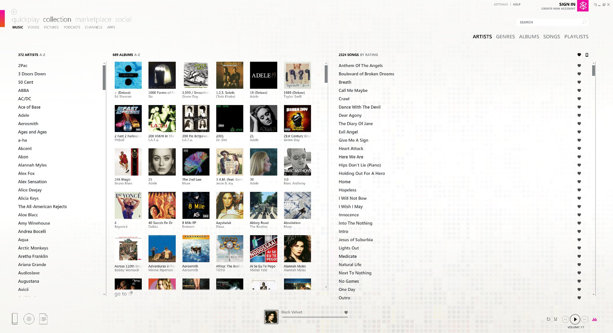
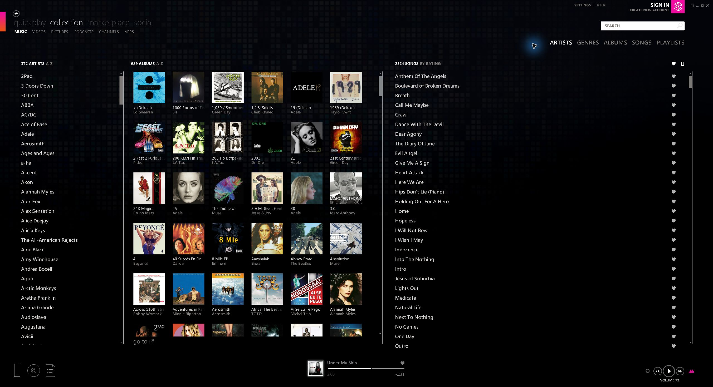
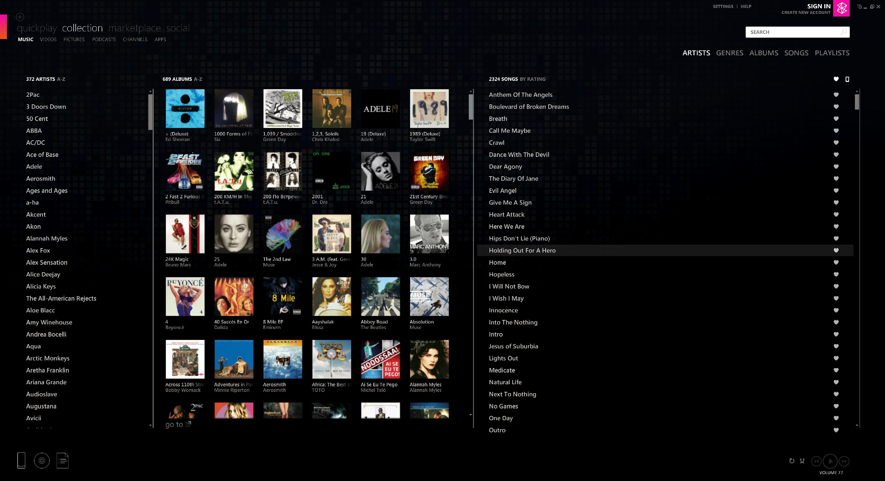
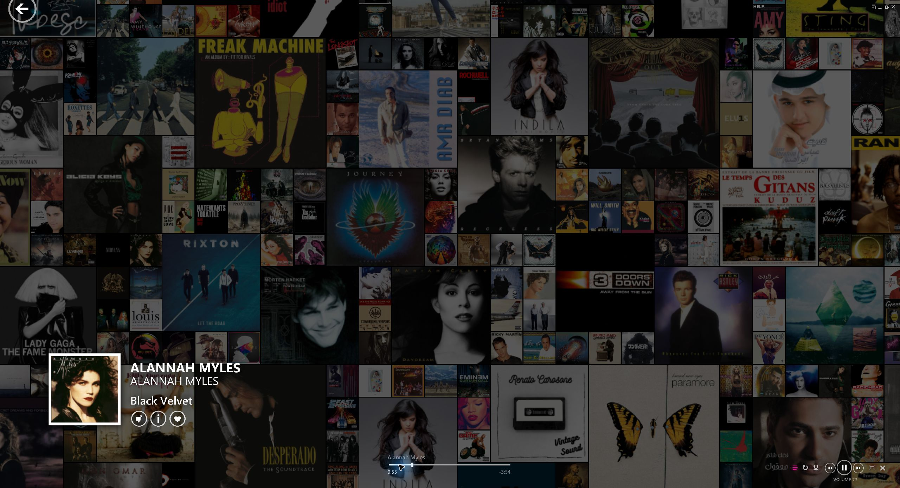
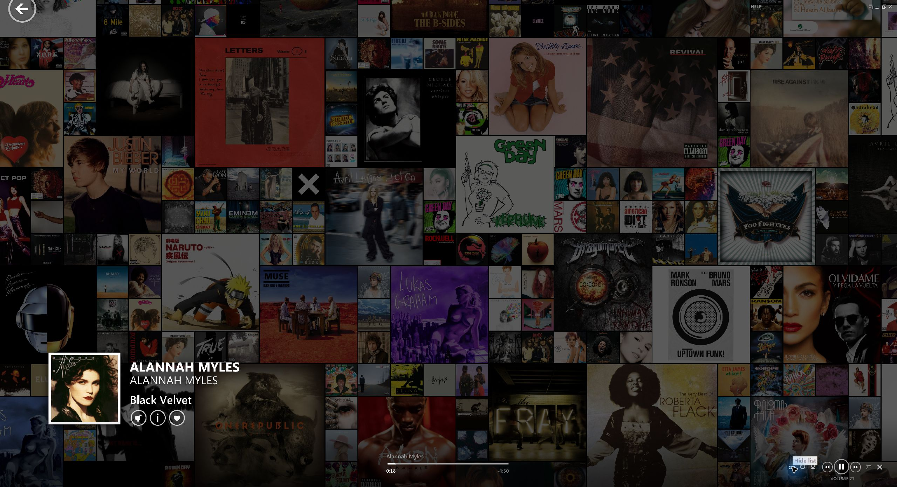
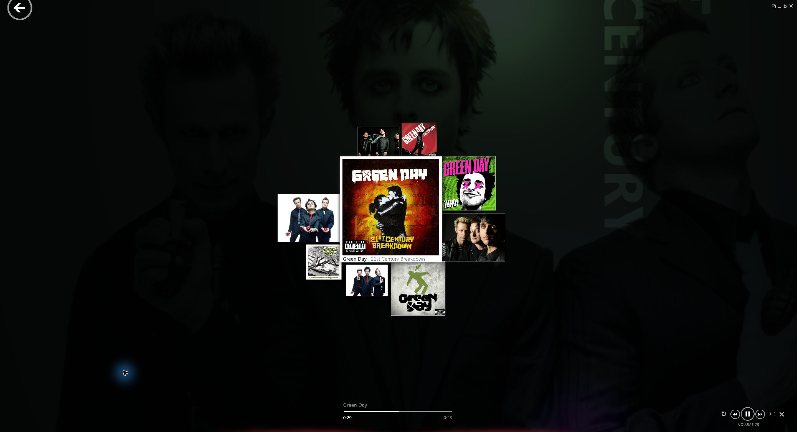

# Screenshots

Existing application-only captures from the enhancement demonstration. They illustrate the earlier visual work, not new captures or certification of every RC7 behavior. No desktop/taskbar or signed-in identity is shown. Album covers and artist photos retain their respective rights.

## Collection: light and dark palettes

Both captures use the recorded 200% interface scale and Premium artwork setting. The inherited dark assets are credited in [CREDITS.md](../CREDITS.md).

| Light | Dark |
| --- | --- |
|  |  |

## Collection: artwork-quality settings

Same Collection → Music → Artists layout, recorded at 200%. Open the images at full size to inspect artwork detail.

| Basic | Premium |
| --- | --- |
|  |  |

## Now Playing mosaic: artwork quality

Both use screen-graphics level 3, which keeps the mosaic visible. The moving mosaic produces different selections/layouts between captures; this is not a pixel-aligned benchmark.

| Basic | Premium |
| --- | --- |
|  |  |

## Local Mixview

